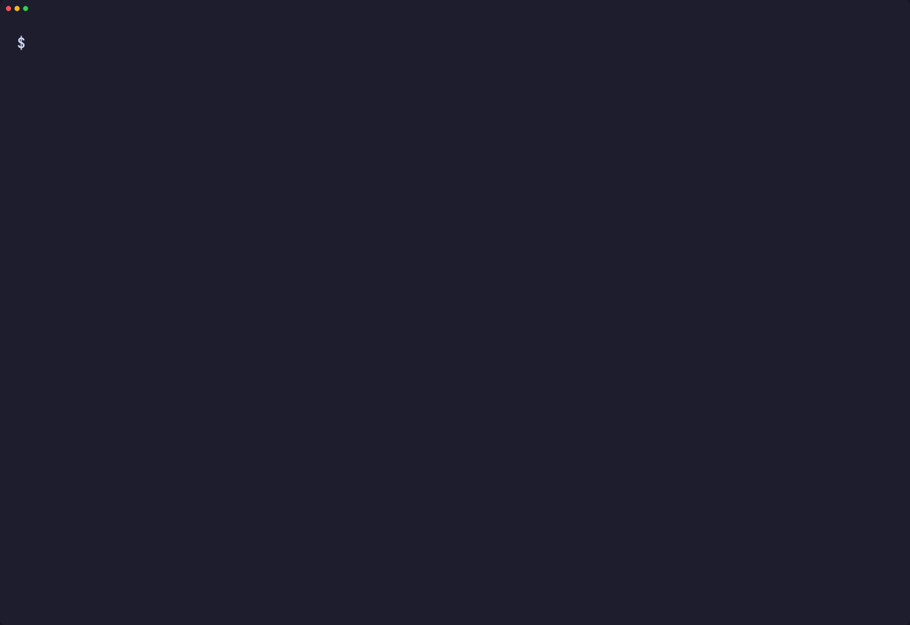
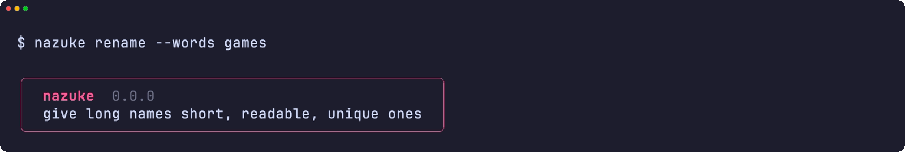
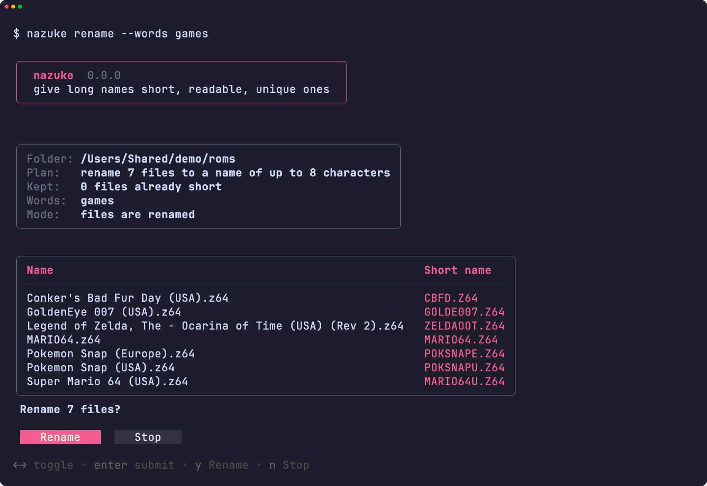
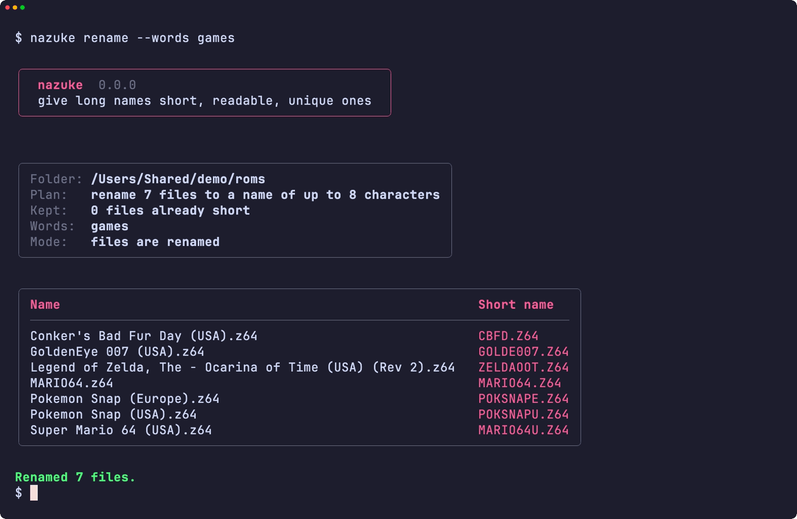
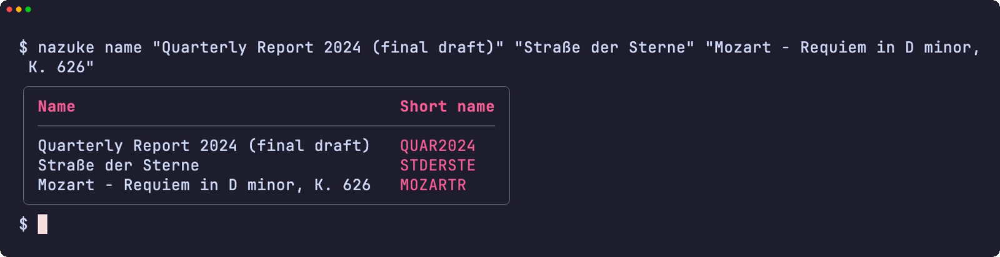
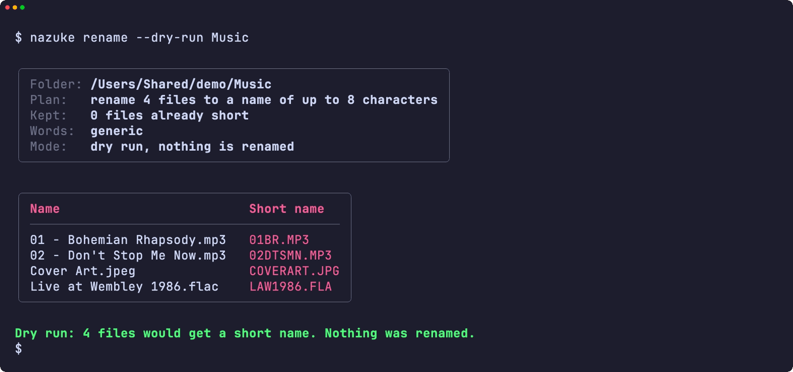
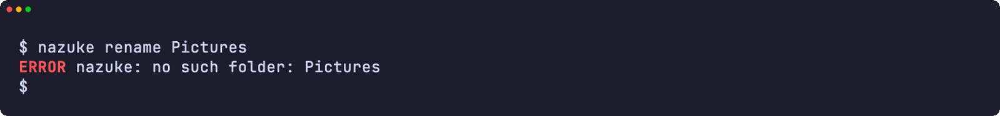
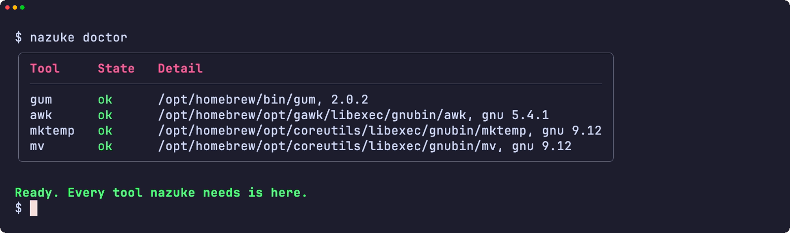
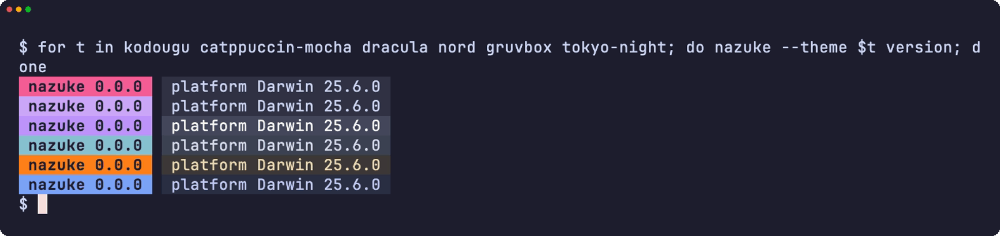
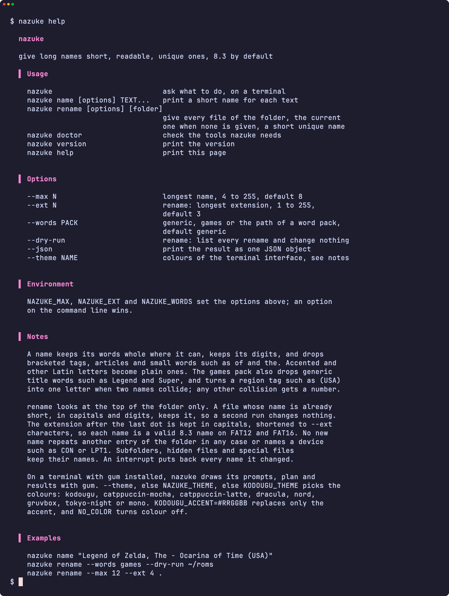

<div align="center">

<h1>nazuke</h1>

<strong>長い名前に、短くて読みやすく重複しない名前を付けます。既定は 8.3 形式、長さは自由に選べます。</strong>

[English](README.md) | 日本語 | [简体中文](README.zh-Hans.md) | [繁體中文 (香港)](README.zh-HK.md)

[](https://github.com/gufranco/nazuke/actions/workflows/ci.yml)
[](https://github.com/gufranco/nazuke/releases/latest)
[](LICENSE)

<p align="center">
  <a href="#quick-start"><strong>クイックスタート</strong></a> |
  <a href="#how-names-are-made">名前の作り方</a> |
  <a href="#development">開発</a>
</p>

</div>

`nazuke` は「名付け」です。`Legend of Zelda, The - Ocarina of Time (USA) (Rev 2)` を `LEGENDOF` ではなく `ZELDAOOT` にし、フォルダ全体のファイルに互いにぶつからない短い名前を付けます。8.3 形式の名前しか読めない古いプレーヤー、カメラ、フラッシュカートやディスクのためのツールです。[kodougu ファミリー](FAMILY.md) の仲間は、ディスクの書き込みと消去、フォルダの仕分け、ビデオ CD の作成を行います。

---

<p align="center">
  
</p>

```console
$ nazuke rename --words games ~/roms

Folder: /Users/me/roms
Plan:   rename 5 files to a name of up to 8 characters
        keep 1 file whose name is already short
Words:  games

Conker's Bad Fur Day (USA).z64 -> CBFD.Z64
Legend of Zelda, The - Ocarina of Time (USA) (Rev 2).z64 -> ZELDAOOT.Z64
Pokemon Snap (Europe).z64 -> POKSNAPE.Z64
Pokemon Snap (USA).z64 -> POKSNAPU.Z64
Super Mario 64 (USA).z64 -> MARIO64U.Z64
Renamed 5 files.
```

<a id="quick-start"></a>

## クイックスタート

### 必要なもの

| ツール | 用途 | インストール |
|:-----|:----|:--------|
| [`gum`](https://github.com/charmbracelet/gum) | 端末の画面：メニュー、入力、表、配色 | `brew install gum`。Homebrew の formula が自動でインストールします |
| `awk`、`mktemp`、`mv` | 名前の採点とファイルの名前変更 | Linux と macOS に標準で入っています |

### インストール

```bash
brew install gufranco/tap/nazuke
```

ソースからインストールする場合:

```bash
git clone https://github.com/gufranco/nazuke.git
cd nazuke
make install
```

`make install` は、ツール本体、単語パック、man ページ、bash・zsh・fish の補完を `~/.local` 以下にコピーし、`nazuke` を `~/.local/bin` に置きます。場所は `PREFIX` で変えられます。Homebrew の formula も同じファイルをインストールします。

### 動作確認

```console
$ nazuke doctor
gum                ok       /opt/homebrew/bin/gum, 2.0.2
awk                ok       /usr/bin/awk, bsd
mktemp             ok       /usr/bin/mktemp, bsd
mv                 ok       /bin/mv, bsd
```

## 使い方

| コマンド | 内容 |
|:--------|:--------|
| `nazuke name [options] TEXT...` | 各テキストの短い名前を 1 行ずつ表示します |
| `nazuke rename [options] [folder]` | フォルダ内のすべてのファイルに短く重複しない名前を付けます。フォルダを省くと現在のフォルダが対象です |
| 引数なしの `nazuke` | 端末上では、どちらを行うかを尋ねます |
| `nazuke doctor` | 必要なツールを、種類とバージョン付きで一覧表示します |
| `nazuke version`、`nazuke help` | バージョン、または使い方の全ページを表示します |

| オプション | 効果 |
|:-------|:-------|
| `--max N` | 名前の最大長。4 から 255、既定は 8 |
| `--ext N` | rename で、拡張子の最大長。1 から 255、既定は 3 |
| `--words PACK` | どんな名前にも使える `generic`、リリース名向けの `games`、または自作の単語パックのパス |
| `--dry-run` | rename で、すべての名前変更を一覧表示し、何も変えません |
| `--json` | 結果をスクリプト向けに一つの JSON オブジェクトとして出力します |
| `--theme NAME` | 端末画面の配色 |

```bash
nazuke name "Quarterly Report 2024 (final draft)"     # QUAR2024
nazuke rename --dry-run ~/Music                       # 先に名前を確認
nazuke rename --max 12 --ext 4 .                      # 長めの名前、.docx はそのまま
```

`NAZUKE_MAX`、`NAZUKE_EXT`、`NAZUKE_WORDS` は同じ設定を環境変数から指定します。コマンドラインのオプションが優先されます。`--` はオプションの終わりを示すので、テキストやフォルダをダッシュで始められます。nazuke はファミリー共通のコマンドライン規約に従います。詳しくは [FAMILY.md](FAMILY.md) を参照してください。

### テーマ

`gum` が入った端末では、nazuke はメニュー、入力、計画、結果を gum で描き、名前を変える前に確認します。パイプやスクリプトでは出力はプレーンテキストのままです。配色は `--theme`、なければ `NAZUKE_THEME`、なければ `KODOUGU_THEME` の順で決まります：`kodougu`（既定）、`catppuccin-mocha`、`catppuccin-latte`、`dracula`、`nord`、`gruvbox`、`tokyo-night`、`mono`。`KODOUGU_ACCENT=#RRGGBB` はアクセント色だけを置き換え、`NO_COLOR` は色をなくします。

<a id="how-names-are-made"></a>

## 名前の作り方

nazuke は名前を整え、短い形をいくつか作り、いちばん読みやすいものを選びます。

- **整える。** `(USA)` や `[!]` のような括弧付きのタグを取り除き、`Legend of Zelda, The` のように末尾に回された冠詞をどけ、所有格の `'s` を外します。アクセント付きの文字やその他のラテン文字は基本の文字になります：`Café` は `CAFE`、`Straße` は `STRASSE`、`Łódź` は `LODZ`。`of` や `the` のような短い語は落とします。
- **形を作る。** 単語をそのまま並べた形、単語を均等に縮めた形、最初の単語と残りの頭文字の形、頭文字だけの形。` - ` や `: ` の後のサブタイトルは頭文字になります。
- **採点する。** 単語がそのまま残る形や、最後の単語が欠けずに残る形は高得点、切り詰めた単語や 1 文字にした単語は低得点で、数字をすべて残す形は加点されます。単語を一つ落とすと、単語パックが一般的な語とする語を落とすときの 10 倍の減点です。そのため `Conker's Bad Fur Day` は `CBFD` になり、games パックでは `Legend of Zelda` から `Legend` を落とせます。

このエンジンは、実際のリリース名 1,414 件で調整された [n64-mr-backup-z64-python](https://github.com/gufranco/n64-mr-backup-z64-python) の名付けを再現し、テストでは 391 件の名前でそのコード自身の出力と照合しています。

### フォルダの名前変更

- 名前がすでに短く、大文字と数字だけでできているファイルはそのままです。そのため nazuke をもう一度実行しても何も変わらず、新しいファイルが古いファイルの名前を変えることもありません。
- 新しい名前は、ファイル、フォルダ、隠しファイルを含むフォルダ内のどの項目とも、大文字小文字を問わず重複せず、`CON` や `LPT1` のようなデバイス名にもなりません。
- 二つの名前がぶつかると、games パックはタグの地域を表す 1 文字を付けます。そのため 3 本の `Pokemon Snap` は `POKSNAPU`、`POKSNAPE`、`POKSNAPJ` になります。それ以外の衝突には番号が付きます：`REPORT`、`REPORT1`。
- 拡張子は残り、大文字にして `--ext` 文字に縮められます。`jpeg`、`tiff`、`html`、`mpeg`、`aiff`、`markdown`、NES の `unif` には一般的な短い形を使います。大文字と数字だけの名前は正しい 8.3 形式の名前なので、FAT12 や FAT16 の機器も長いファイル名なしで読めます。最後のドットの後ろが拡張子と見なされるのは、1 から 8 文字の英数字で、少なくとも 1 文字が英字のときだけです。そのため `Rally 2.0` はバージョン番号を保ちます。
- サブフォルダ、隠しファイル、特殊ファイルは名前を変えません。シンボリックリンクはリンク自体の名前を変え、リンク先には触れません。
- 各ファイルはまず隠れた一時的な名前に移り、それから新しい名前に移ります。そのため大文字小文字を区別しないディスクでも大文字小文字だけの変更ができ、中断すると、その実行で変えた名前がすべて元に戻ります。

### 単語パック

`--words` には、既定の `generic`、`games`、または自作のテキストファイルのパスを指定します：

```text
fallback DOC
stopwords OF THE AND
articles THE A AN
droppable DRAFT FINAL COPY
region USA U
```

`fallback` は残すものがないテキストの名前、`droppable` は落としても減点が小さい語、各 `region` 行はタグの語とその 1 文字の組です。読めない行があると nazuke は止まり、その行を示します。

<a id="portability"></a>

## 移植性

すべて POSIX `sh` と POSIX `awk` で書かれ、ShellCheck `-o all` の指摘はゼロです。テストは macOS の `/bin/sh`、システムの bash 3.2 と zsh、Homebrew の最新の bash と zsh、Ubuntu の `dash`、`bash`、`zsh` で実行します。名付けは `LC_ALL=C` で動くので、macOS の awk、gawk、mawk、BusyBox の awk で同じ名前になります。

よく使われる六つのツールセットのどれでも動きます：Linux の uutils、GNU、BusyBox のツール、そして macOS 付属のツール、Homebrew の新しい版、Homebrew の uutils ツールです。CI はそれぞれで全テストを実行し、`nazuke doctor` は `awk`、`mktemp`、`mv` の種類とバージョンを表示するので、不具合報告でどのツールが動いたかが分かります。

<a id="screens"></a>

## 画面

<details>
<summary>すべての画面は <code>make screens</code> で実際の実行から録画しています</summary>
<br>

<table>
<tr>
<td width="50%" valign="top"><br><sub>ヘッダーの下のフォルダ入力</sub></td>
<td width="50%" valign="top"><br><sub>計画と確認</sub></td>
</tr>
<tr>
<td width="50%" valign="top"><br><sub>結果</sub></td>
<td width="50%" valign="top"><br><sub>どんなテキストにも短い名前</sub></td>
</tr>
<tr>
<td width="50%" valign="top"><br><sub>何も変えない試し実行</sub></td>
<td width="50%" valign="top"><br><sub>エラー</sub></td>
</tr>
<tr>
<td width="50%" valign="top"><br><sub>doctor が必要なツールをすべて確認</sub></td>
<td width="50%" valign="top"><br><sub>六つのテーマでのバージョン表示</sub></td>
</tr>
<tr>
<td width="50%" valign="top"><br><sub>ヘルプページ</sub></td>
<td width="50%" valign="top"></td>
</tr>
</table>

</details>

<a id="development"></a>

## 開発

| コマンド | 説明 |
|:--------|:------------|
| `make fmt` | すべてのスクリプトを shfmt で整形します |
| `make lint` | shfmt、すべてのスクリプト・テスト・補完への ShellCheck、man ページへの mandoc |
| `make test` | システムの `sh` で `bats` テストを実行します |
| `make test-all` | 同じテストをすべてのシェルで実行します。macOS では bash と zsh の両方の版を含みます |
| `make test-linux` | 同じテストを Ubuntu コンテナで実行します |
| `make coverage` | この Mac と Ubuntu コンテナでの bashcov 行カバレッジを合わせ、CI と同じ 100% の基準で確認します |
| `make screens` | macOS 上で、実際のツールから VHS で README の画面を録画します |

テストは実際のファイルシステム上で実際のフォルダの名前を変えます。失敗だけを `PATH` 上の小さなラッパーで注入します。`main` への push で CI が通ると semantic-release が動きます：`feat` または `fix` のコミットはリリースを公開し、[`lib/core.sh`](lib/core.sh) の `NAZUKE_VERSION` と CHANGELOG を更新し、Homebrew の formula を更新します。

## ライセンス

[MIT](LICENSE)。
