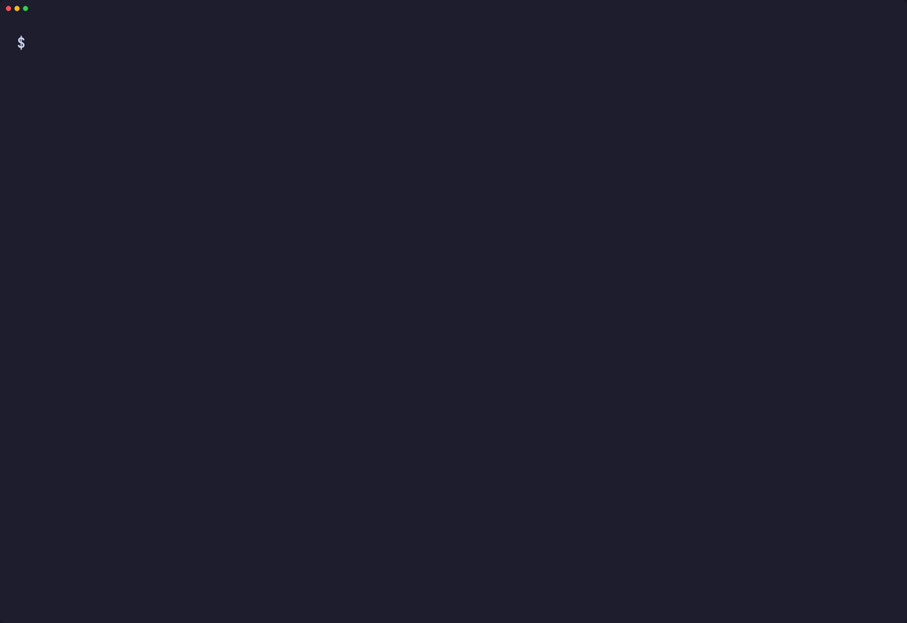
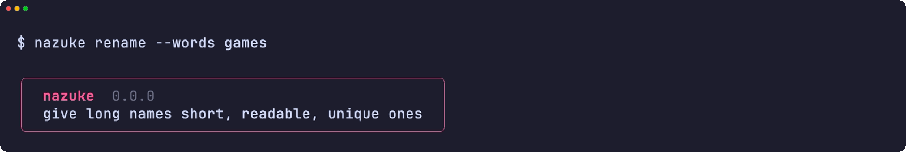
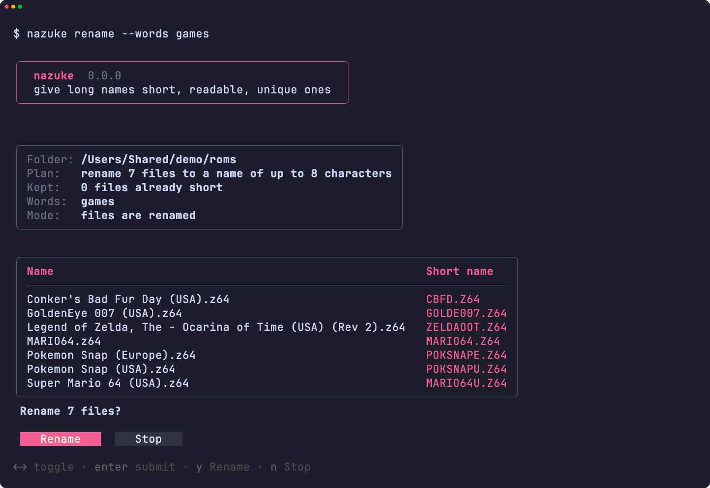
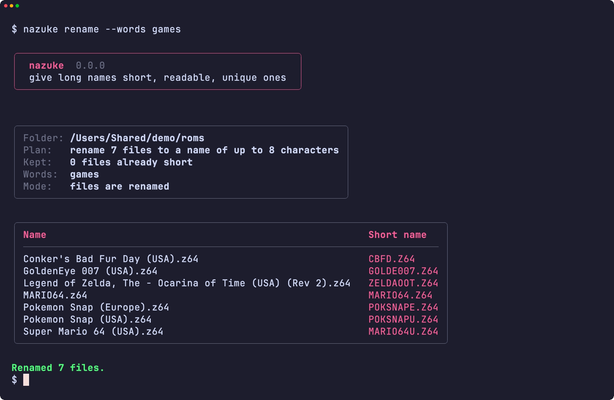
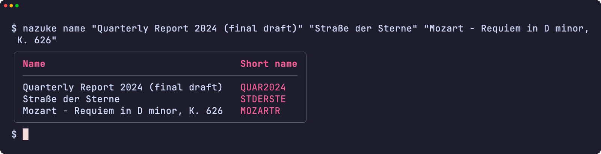
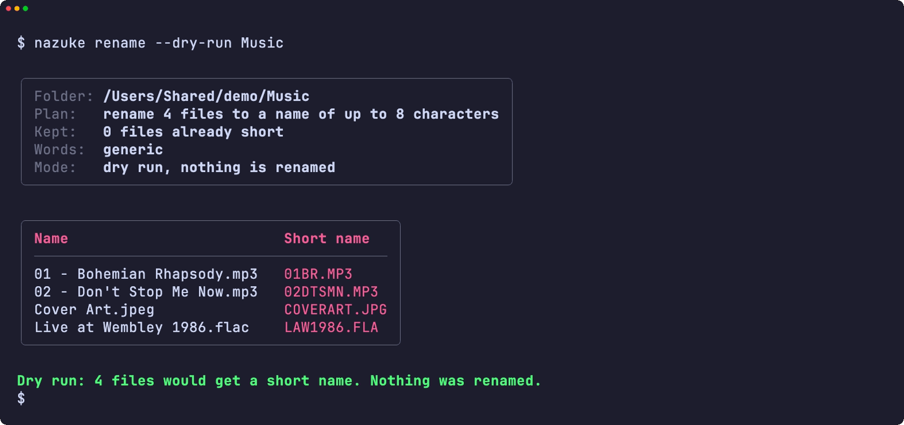
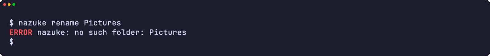
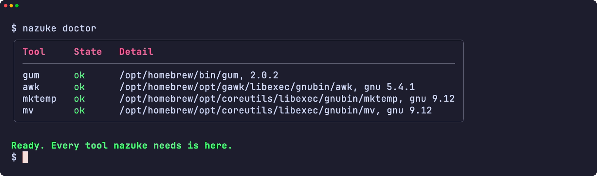
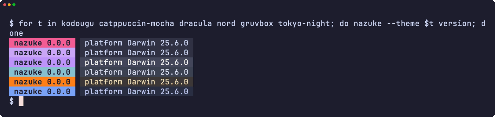
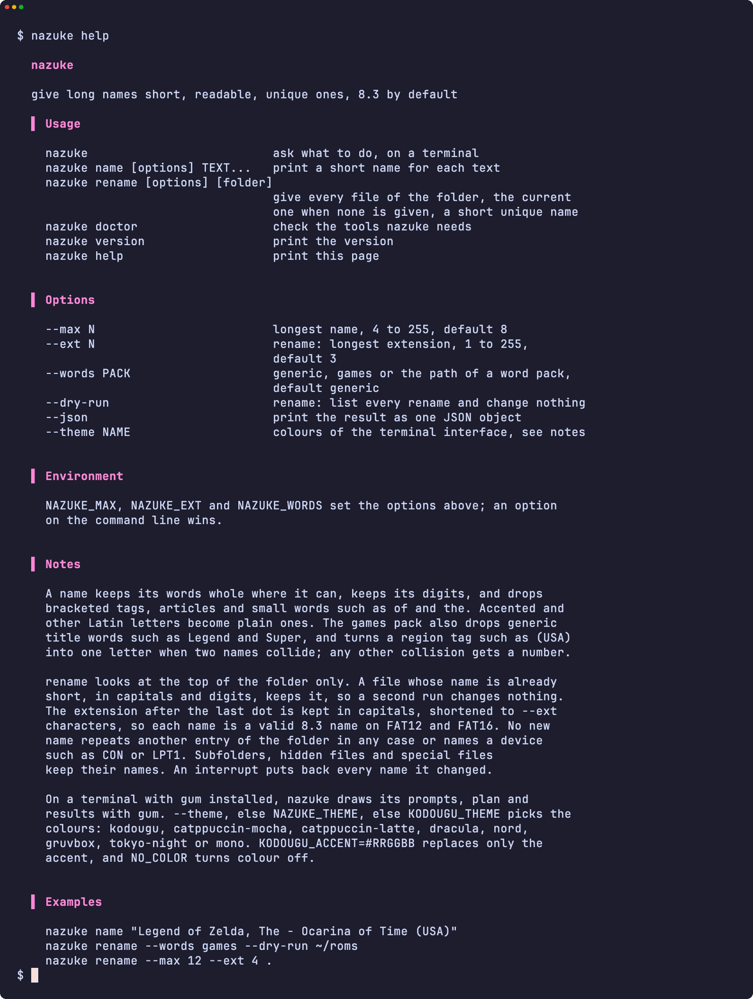

<div align="center">

<h1>nazuke</h1>

<strong>Give long names short, readable, unique ones: 8.3 by default, any length you choose.</strong>

English | [日本語](README.ja.md) | [简体中文](README.zh-Hans.md) | [繁體中文 (香港)](README.zh-HK.md)

[](https://github.com/gufranco/nazuke/actions/workflows/ci.yml)
[](https://github.com/gufranco/nazuke/releases/latest)
[](LICENSE)

<p align="center">
  <a href="#quick-start"><strong>Quick start</strong></a> |
  <a href="#how-names-are-made">How names are made</a> |
  <a href="#development">Development</a>
</p>

</div>

`nazuke` is 名付け, Japanese for naming. It turns `Legend of Zelda, The - Ocarina of Time (USA) (Rev 2)` into `ZELDAOOT` rather than `LEGENDOF`, and gives a whole folder short names that never collide, for old players, cameras, flash carts and disks that only read 8.3 names. Its companions in the [kodougu family](FAMILY.md) write disks, wipe them, sort folders and burn Video CDs.

---

<p align="center">
  
</p>

```console
$ nazuke rename --words games ~/roms

Folder: /Users/me/roms
Plan:   rename 5 files to a name of up to 8 characters
        keep 1 file whose name is already short
Words:  games

Conker's Bad Fur Day (USA).z64 -> CBFD.Z64
Legend of Zelda, The - Ocarina of Time (USA) (Rev 2).z64 -> ZELDAOOT.Z64
Pokemon Snap (Europe).z64 -> POKSNAPE.Z64
Pokemon Snap (USA).z64 -> POKSNAPU.Z64
Super Mario 64 (USA).z64 -> MARIO64U.Z64
Renamed 5 files.
```

<a id="quick-start"></a>

## Quick start

### Prerequisites

| Tool | Why | Install |
|:-----|:----|:--------|
| [`gum`](https://github.com/charmbracelet/gum) | The terminal interface: menus, prompts, tables and colours | `brew install gum`. Installed automatically by the Homebrew formula |
| `awk`, `mktemp`, `mv` | Score the names and rename the files | Part of every Linux and macOS system |

### Install

```bash
brew install gufranco/tap/nazuke
```

Or from source:

```bash
git clone https://github.com/gufranco/nazuke.git
cd nazuke
make install
```

`make install` copies the tool, its word packs, its man page and its bash, zsh and fish completions under `~/.local`, and puts `nazuke` in `~/.local/bin`; set `PREFIX` to change that. The Homebrew formula installs the same files.

### Verify

```console
$ nazuke doctor
gum                ok       /opt/homebrew/bin/gum, 2.0.2
awk                ok       /usr/bin/awk, bsd
mktemp             ok       /usr/bin/mktemp, bsd
mv                 ok       /bin/mv, bsd
```

## Usage

| Command | Purpose |
|:--------|:--------|
| `nazuke name [options] TEXT...` | Print the short name of each text, one per line |
| `nazuke rename [options] [folder]` | Give every file of the folder, the current one when none is given, a short unique name |
| `nazuke` with no arguments | Ask which of the two to do, on a terminal |
| `nazuke doctor` | List the tools nazuke needs, with the flavor and version of each |
| `nazuke version`, `nazuke help` | Print the version or the full usage page |

| Option | Effect |
|:-------|:-------|
| `--max N` | The longest name, 4 to 255, default 8 |
| `--ext N` | For rename, the longest extension, 1 to 255, default 3 |
| `--words PACK` | `generic` for any name, `games` for release names, or the path of your own word pack |
| `--dry-run` | For rename, list every rename and change nothing |
| `--json` | Print the result as one JSON object, for scripts |
| `--theme NAME` | Colours of the terminal interface |

```bash
nazuke name "Quarterly Report 2024 (final draft)"     # QUAR2024
nazuke rename --dry-run ~/Music                       # see the names first
nazuke rename --max 12 --ext 4 .                      # longer names, .docx kept
```

`NAZUKE_MAX`, `NAZUKE_EXT` and `NAZUKE_WORDS` set the same options from the environment; an option on the command line wins. `--` ends the options, so a text or a folder may start with a dash. nazuke follows the shared command-line contract of its family, described in [FAMILY.md](FAMILY.md).

### Themes

On a terminal with `gum` installed, nazuke draws its menu, prompts, plan and results with gum, and asks before renaming; in a pipe or a script the output stays plain text. `--theme`, else `NAZUKE_THEME`, else `KODOUGU_THEME` picks the colours: `kodougu` (default), `catppuccin-mocha`, `catppuccin-latte`, `dracula`, `nord`, `gruvbox`, `tokyo-night` or `mono`. `KODOUGU_ACCENT=#RRGGBB` replaces only the accent, and `NO_COLOR` turns colour off.

<a id="how-names-are-made"></a>

## How names are made

nazuke cleans the name, builds several short forms of it and keeps the one that reads best.

- **Cleaning.** Bracketed tags such as `(USA)` and `[!]` go, except the number of a disc, disk, CD, side, tape or part, so `(Disc 2)` keeps its `2`. A trailing article moves out of the way, as in `Legend of Zelda, The`, and possessives lose their `'s`. Accented and other Latin letters become plain ones: `Café` is `CAFE`, `Straße` is `STRASSE`, `Łódź` is `LODZ`. Small words such as `of` and `the` are dropped.
- **Forms.** The words whole, the words shrunk evenly, the first word with the initials of the rest, and the initials alone; a subtitle after ` - ` or `: ` becomes its initials.
- **Score.** Whole words and an intact last word score high; truncated words and words cut to a single letter score low; a form that keeps every digit scores higher. Dropping a word costs ten times more than dropping one the word pack calls generic, which is why `Conker's Bad Fur Day` becomes `CBFD` while the games pack lets `Legend of Zelda` lose `Legend`.
- **Digits that leave no room.** Digits are never cut, so a long date or part number can fill the name. Then a run of five or more digits goes first, as in `Pyramid_9820_Brochure_198611`, which becomes `PYR9820B`, and every digit after that, so `IMG 2024 03 11 Beach Sunset` becomes `IMGBS`. A name of digits only keeps its first ones.

The engine reproduces the naming of [n64-mr-backup-z64-python](https://github.com/gufranco/n64-mr-backup-z64-python), tuned on 1,414 real release names, and the tests check it against that code's own output for 391 names. Two of them differ on purpose: where that code gives up and prints its fallback word because the digits leave no room, nazuke names them from their words.

### Renaming a folder

- A file whose name is already short, in capitals and digits, keeps it, so running nazuke again changes nothing and a new file never renames an old one.
- No new name repeats another entry of the folder, files, folders and hidden files alike, in any case, and none is a device name such as `CON` or `LPT1`.
- When three or more files share the part of their name before ` - `, that part is dropped from each, so a folder of `HBMAME (v0.209) - mslughp08.zip` and its siblings is named after the set names, `MSLUGH08`, instead of `HBMAME` and a counter.
- When two names collide, the games pack adds the region letter of their tag, so the three `Pokemon Snap` releases become `POKSNAPU`, `POKSNAPE` and `POKSNAPJ`. Any other collision gets a number, `REPORT`, `REPORT1`, which grows past 999 for as long as it fits in the name.
- The extension is kept, written in capitals and shortened to `--ext` characters, with the usual short forms for `jpeg`, `tiff`, `html`, `mpeg`, `aiff`, `markdown` and the NES `unif`. A whole name in capitals and digits is a valid 8.3 name, so a FAT12 or FAT16 device reads it without long file names. Text after the last dot is an extension only when it is one to eight letters and digits with a letter among them, so `Rally 2.0` keeps its version.
- Subfolders, hidden files and special files keep their names. A symbolic link is renamed itself, never its target.
- Each file moves to a hidden temporary name, then to its new name, so a rename that only changes case works on a disk that ignores case, and an interrupt puts back every name the run changed.

### Word packs

`--words` takes `generic`, the default, `games`, or the path of a text file of your own:

```text
fallback DOC
stopwords OF THE AND
articles THE A AN
droppable DRAFT FINAL COPY
region USA U
```

`fallback` names a text with nothing to keep, `droppable` lists words that are cheap to drop, and each `region` line pairs a tag word with its letter. A line nazuke cannot read stops it and names the line.

## Portability

Everything is POSIX `sh` and POSIX `awk`, with ShellCheck `-o all` at zero findings. The suites run on macOS under `/bin/sh`, the system's bash 3.2 and zsh, and Homebrew's current bash and zsh, and on Ubuntu under `dash`, `bash` and `zsh`. The naming runs under `LC_ALL=C`, so macOS awk, gawk, mawk and BusyBox awk give the same names.

Every run works on the six toolsets in common use: Linux with uutils, GNU or BusyBox tools, and macOS with the tools it ships, Homebrew's newer builds of them, or Homebrew's uutils tools. CI runs the whole suite on each, and `nazuke doctor` names the flavor and version of `awk`, `mktemp` and `mv`, so a bug report says which tools ran.

<a id="screens"></a>

## Screens

<details>
<summary>Every screen, recorded from a real run with <code>make screens</code></summary>
<br>

<table>
<tr>
<td width="50%" valign="top"><br><sub>The folder prompt, under the header</sub></td>
<td width="50%" valign="top"><br><sub>The plan, then the confirmation</sub></td>
</tr>
<tr>
<td width="50%" valign="top"><br><sub>The result</sub></td>
<td width="50%" valign="top"><br><sub>Short names for any text</sub></td>
</tr>
<tr>
<td width="50%" valign="top"><br><sub>A dry run, changing nothing</sub></td>
<td width="50%" valign="top"><br><sub>An error</sub></td>
</tr>
<tr>
<td width="50%" valign="top"><br><sub>doctor checks every tool it needs</sub></td>
<td width="50%" valign="top"><br><sub>The version badge in six themes</sub></td>
</tr>
<tr>
<td width="50%" valign="top"><br><sub>The help page</sub></td>
<td width="50%" valign="top"></td>
</tr>
</table>

</details>

<a id="development"></a>

## Development

| Command | Description |
|:--------|:------------|
| `make fmt` | Formats every script with shfmt |
| `make lint` | shfmt, ShellCheck on every script, test and completion, and mandoc on the man page |
| `make test` | The `bats` tests under the system `sh` |
| `make test-all` | The same tests under every shell, both builds of bash and zsh included on macOS |
| `make test-linux` | The same tests in an Ubuntu container |
| `make coverage` | bashcov line coverage on this Mac and in the Ubuntu container, merged, with the 100% gate CI enforces |
| `make screens` | Record the README screens from the real tool with VHS, on macOS |

The tests rename real folders on the real filesystem; only failures are injected, through small wrappers on `PATH`. Once CI passes on a push to `main`, semantic-release runs: a `feat` or `fix` commit publishes a release, updates `NAZUKE_VERSION` in [`lib/core.sh`](lib/core.sh) and the CHANGELOG, and bumps the Homebrew formula.

## License

[MIT](LICENSE).
