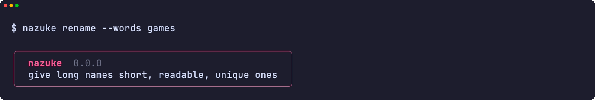
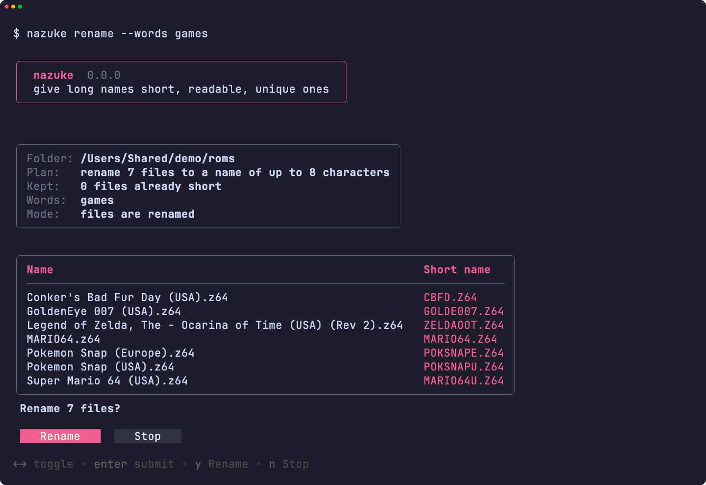
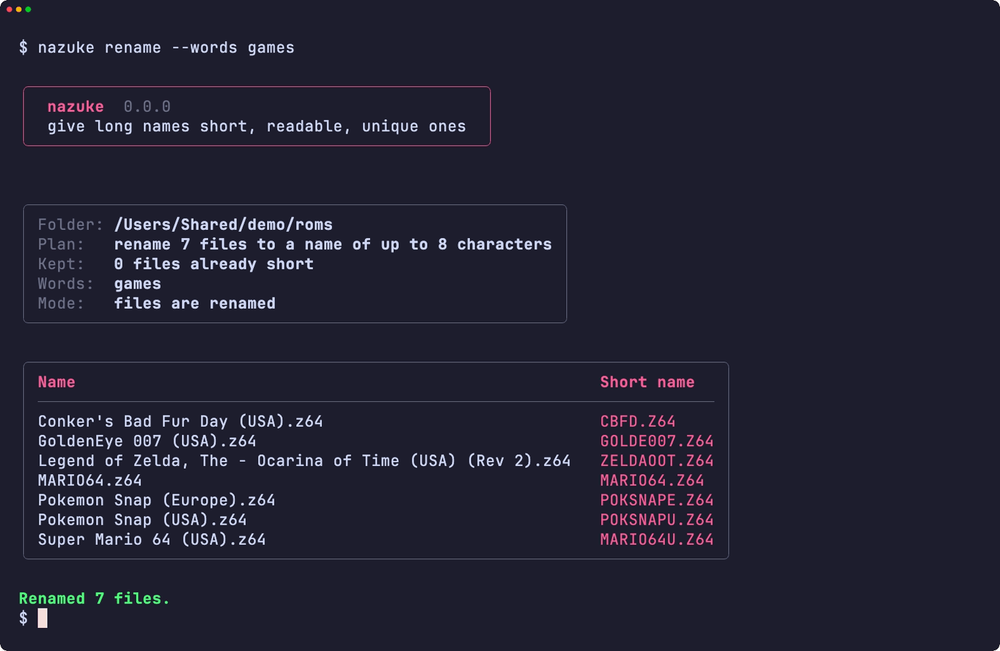
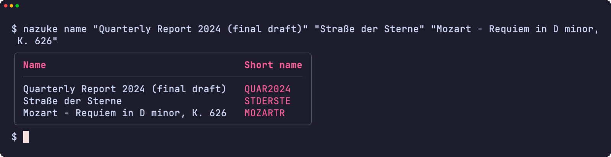
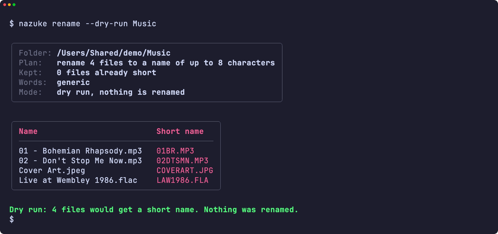
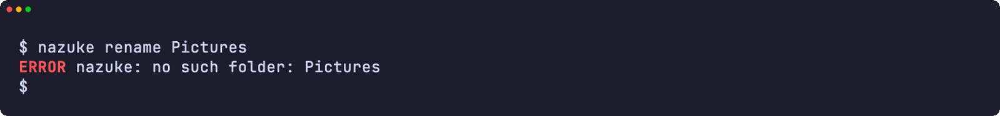
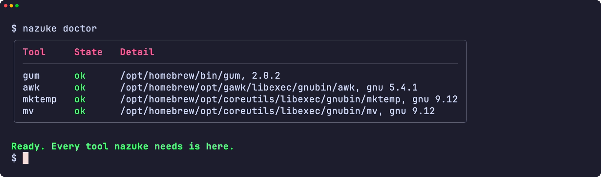
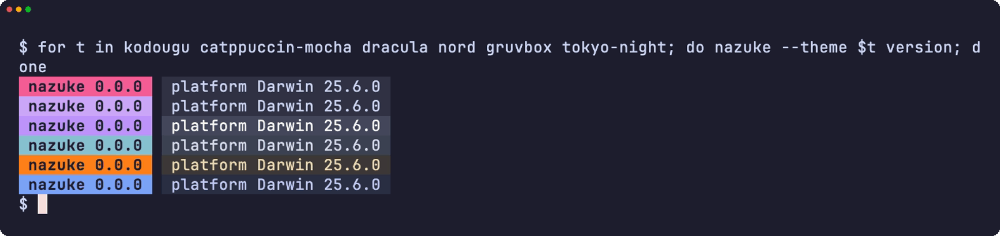
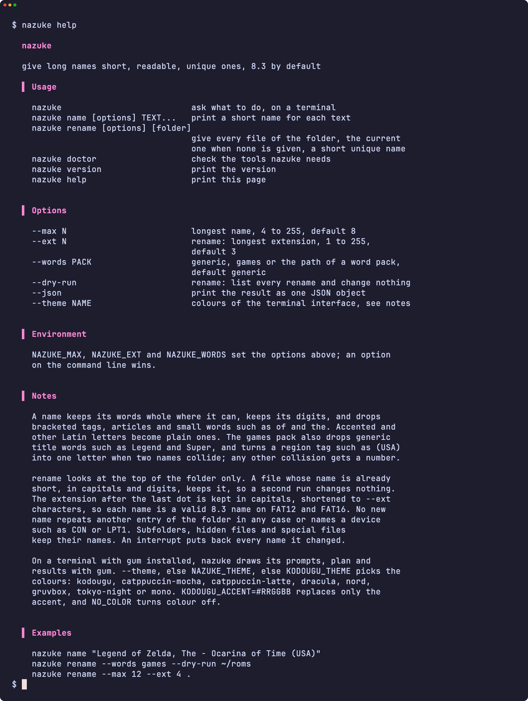

<div align="center">

<h1>nazuke</h1>

<strong>為長名稱起一個簡短、易讀而且不重複的名稱：預設 8.3 格式，長度可以自由選擇。</strong>

[English](README.md) | [日本語](README.ja.md) | [简体中文](README.zh-Hans.md) | 繁體中文 (香港)

[](https://github.com/gufranco/nazuke/actions/workflows/ci.yml)
[](https://github.com/gufranco/nazuke/releases/latest)
[](LICENSE)

<p align="center">
  <a href="#quick-start"><strong>快速開始</strong></a> |
  <a href="#how-names-are-made">名稱如何產生</a> |
  <a href="#development">開發</a>
</p>

</div>

`nazuke` 是日語的「名付け」，意思是命名。它把 `Legend of Zelda, The - Ocarina of Time (USA) (Rev 2)` 變成 `ZELDAOOT`，而不是 `LEGENDOF`，並為整個資料夾的檔案起互不衝突的短名稱，適用於只能讀取 8.3 檔案名稱的舊式播放器、相機、燒錄卡和磁碟。它在 [kodougu 系列](FAMILY.md) 中的同伴負責寫入和清除磁碟、整理資料夾以及燒錄 Video CD。

---

<p align="center">
  
</p>

```console
$ nazuke rename --words games ~/roms

Folder: /Users/me/roms
Plan:   rename 5 files to a name of up to 8 characters
        keep 1 file whose name is already short
Words:  games

Conker's Bad Fur Day (USA).z64 -> CBFD.Z64
Legend of Zelda, The - Ocarina of Time (USA) (Rev 2).z64 -> ZELDAOOT.Z64
Pokemon Snap (Europe).z64 -> POKSNAPE.Z64
Pokemon Snap (USA).z64 -> POKSNAPU.Z64
Super Mario 64 (USA).z64 -> MARIO64U.Z64
Renamed 5 files.
```

<a id="quick-start"></a>

## 快速開始

### 前置要求

| 工具 | 用途 | 安裝 |
|:-----|:----|:--------|
| [`gum`](https://github.com/charmbracelet/gum) | 終端機介面：選單、輸入、表格和配色 | `brew install gum`。Homebrew formula 會自動安裝 |
| `awk`、`mktemp`、`mv` | 為名稱評分並更改檔案名稱 | Linux 和 macOS 系統內置 |

### 安裝

```bash
brew install gufranco/tap/nazuke
```

或從原始碼安裝：

```bash
git clone https://github.com/gufranco/nazuke.git
cd nazuke
make install
```

`make install` 會把工具本身、詞彙包、man 說明頁以及 bash、zsh、fish 自動補全複製到 `~/.local` 下，並把 `nazuke` 放進 `~/.local/bin`；設定 `PREFIX` 可以改變位置。Homebrew formula 安裝的是同樣的檔案。

### 驗證

```console
$ nazuke doctor
gum                ok       /opt/homebrew/bin/gum, 2.0.2
awk                ok       /usr/bin/awk, bsd
mktemp             ok       /usr/bin/mktemp, bsd
mv                 ok       /bin/mv, bsd
```

## 用法

| 指令 | 作用 |
|:--------|:--------|
| `nazuke name [options] TEXT...` | 逐行列印每段文字的短名稱 |
| `nazuke rename [options] [folder]` | 為資料夾中的每個檔案起一個簡短而不重複的名稱；沒有指定資料夾時使用目前的資料夾 |
| 不帶參數的 `nazuke` | 在終端機上詢問要做哪一項 |
| `nazuke doctor` | 列出 nazuke 需要的工具，以及每個工具的類型和版本 |
| `nazuke version`、`nazuke help` | 列印版本或完整的用法說明 |

| 選項 | 效果 |
|:-------|:-------|
| `--max N` | 名稱的最大長度，4 至 255，預設 8 |
| `--ext N` | 用於 rename，副檔名的最大長度，1 至 255，預設 3 |
| `--words PACK` | 適用於任何名稱的 `generic`、適用於發行名稱的 `games`，或你自己的詞彙包路徑 |
| `--dry-run` | 用於 rename，列出每個更名，不作任何更改 |
| `--json` | 以一個 JSON 物件輸出結果，供指令碼使用 |
| `--theme NAME` | 終端機介面的配色 |

```bash
nazuke name "Quarterly Report 2024 (final draft)"     # QUAR2024
nazuke rename --dry-run ~/Music                       # 先看名稱
nazuke rename --max 12 --ext 4 .                      # 較長的名稱，保留 .docx
```

`NAZUKE_MAX`、`NAZUKE_EXT` 和 `NAZUKE_WORDS` 透過環境變數設定相同的選項；命令列上的選項優先。`--` 表示選項結束，所以文字或資料夾可以用短橫線開頭。nazuke 遵循同系列工具共用的命令列約定，詳見 [FAMILY.md](FAMILY.md)。

### 主題

在裝有 `gum` 的終端機上，nazuke 用 gum 繪製選單、輸入、計劃和結果，並在更名前要求確認；在管道或指令碼中，輸出仍是純文字。配色依次由 `--theme`、`NAZUKE_THEME`、`KODOUGU_THEME` 決定：`kodougu`（預設）、`catppuccin-mocha`、`catppuccin-latte`、`dracula`、`nord`、`gruvbox`、`tokyo-night` 或 `mono`。`KODOUGU_ACCENT=#RRGGBB` 只取代強調色，`NO_COLOR` 關閉顏色。

<a id="how-names-are-made"></a>

## 名稱如何產生

nazuke 先整理名稱，再產生幾種短形式，最後保留最易讀的一個。

- **整理。** 刪去 `(USA)`、`[!]` 這類括號標籤，但保留光碟、磁碟、CD、面、磁帶或分部的編號，所以 `(Disc 2)` 的 `2` 會留下。移開像 `Legend of Zelda, The` 那樣放在末尾的冠詞，並刪去所有格的 `'s`。帶重音的字母和其他拉丁字母變成基本字母：`Café` 是 `CAFE`，`Straße` 是 `STRASSE`，`Łódź` 是 `LODZ`。`of`、`the` 這類短詞會被刪去。
- **形式。** 完整的單詞、平均縮短的單詞、第一個單詞加其餘單詞的首字母，以及只有首字母的形式；` - ` 或 `: ` 後面的副標題變成首字母。
- **評分。** 完整保留的單詞和完整的最後一個單詞得分高，截短的單詞和只剩一個字母的單詞得分低，保留全部數字的形式會加分。刪去一個單詞的扣分是刪去詞彙包認定為通用詞的十倍，所以 `Conker's Bad Fur Day` 變成 `CBFD`，而 games 詞彙包容許 `Legend of Zelda` 刪去 `Legend`。
- **數字放不下時。** 數字不會被截短，所以長日期或型號可能佔滿整個名稱。這時先刪去五位或以上的數字串，`Pyramid_9820_Brochure_198611` 變成 `PYR9820B`；仍然放不下就刪去所有數字，`IMG 2024 03 11 Beach Sunset` 變成 `IMGBS`。只有數字的名稱保留開頭的數字。

這個引擎重現了 [n64-mr-backup-z64-python](https://github.com/gufranco/n64-mr-backup-z64-python) 的命名方式，那套規則用 1,414 個真實發行名稱調校過；測試用 391 個名稱，把結果與那段程式碼自身的輸出逐一核對。其中兩個刻意不同：那段程式碼因數字放不下而輸出後備詞的名稱，nazuke 會用其中的單詞命名。

### 為資料夾更名

- 名稱已經簡短、只由大寫字母和數字組成的檔案保持不變，所以再次執行 nazuke 不會改變任何東西，新檔案也不會令舊檔案更名。
- 新名稱不會與資料夾中的任何項目重複，包括檔案、資料夾和隱藏檔案，不分大小寫，也不會是 `CON`、`LPT1` 這類裝置名稱。
- 三個或以上的檔案共用 ` - ` 前面的部分，而刪去它能區分更多檔案時，這部分會從各自的名稱中刪去，所以 `HBMAME (v0.209) - mslughp08.zip` 和同類檔案的資料夾會按套件名稱命名為 `MSLUGH08`，而不是 `HBMAME` 加編號。同一標題的不同版本，例如 `Legend of Zelda, The - Ocarina of Time (USA)` 和它的 `(Beta)`，會保留共用部分，所以每個名稱仍以 `ZELD` 開頭。
- 兩個名稱衝突時，games 詞彙包會加上標籤對應的地區字母，所以三個 `Pokemon Snap` 發行版變成 `POKSNAPU`、`POKSNAPE` 和 `POKSNAPJ`。其他衝突則加上編號：`REPORT`、`REPORT1`，只要名稱放得下，編號可以超過 999。
- 副檔名會保留，改為大寫並縮短至 `--ext` 個字元，`jpeg`、`tiff`、`html`、`mpeg`、`aiff`、`markdown` 和 NES 的 `unif` 使用常見的短形式。只由大寫字母和數字組成的名稱是有效的 8.3 名稱，所以 FAT12 或 FAT16 裝置毋須長檔案名稱也能讀取。只有當最後一個點後面是 1 至 8 個字母和數字、而且至少有一個字母時，才算副檔名，所以 `Rally 2.0` 會保留版本號。
- 子資料夾、隱藏檔案和特殊檔案不會更名。符號連結更改的是連結本身的名稱，不會碰它指向的目標。
- 每個檔案先移到一個隱藏的臨時名稱，再移到新名稱，所以在不分大小寫的磁碟上也能只改大小寫，中斷時會把這次執行改過的名稱全部還原。

### 詞彙包

`--words` 接受預設的 `generic`、`games`，或你自己的文字檔路徑：

```text
fallback DOC
stopwords OF THE AND
articles THE A AN
droppable DRAFT FINAL COPY
region USA U
```

`fallback` 是沒有可保留內容的文字所用的名稱，`droppable` 列出可以低代價刪去的詞，每行 `region` 把一個標籤詞和它的字母配成一對。遇到無法讀取的行時，nazuke 會停止並指出那一行。

<a id="portability"></a>

## 可攜性

全部用 POSIX `sh` 和 POSIX `awk` 編寫，ShellCheck `-o all` 零警告。測試在 macOS 的 `/bin/sh`、系統內置的 bash 3.2 和 zsh、Homebrew 的最新 bash 和 zsh，以及 Ubuntu 的 `dash`、`bash` 和 `zsh` 下執行。命名在 `LC_ALL=C` 下進行，所以 macOS awk、gawk、mawk 和 BusyBox awk 得出的名稱相同。

它能在六種常用工具集上執行：Linux 上的 uutils、GNU 或 BusyBox 工具，以及 macOS 內置的工具、Homebrew 中較新的版本或 Homebrew 的 uutils 工具。CI 在每種工具集上執行全部測試，`nazuke doctor` 會列出 `awk`、`mktemp` 和 `mv` 的類型和版本，讓錯誤報告說明用的是哪些工具。

<a id="screens"></a>

## 畫面

<details>
<summary>全部畫面均由 <code>make screens</code> 錄自真實執行</summary>
<br>

<table>
<tr>
<td width="50%" valign="top"><br><sub>標題下的資料夾輸入</sub></td>
<td width="50%" valign="top"><br><sub>計劃與確認</sub></td>
</tr>
<tr>
<td width="50%" valign="top"><br><sub>結果</sub></td>
<td width="50%" valign="top"><br><sub>任何文字的短名稱</sub></td>
</tr>
<tr>
<td width="50%" valign="top"><br><sub>不作任何更改的試運行</sub></td>
<td width="50%" valign="top"><br><sub>錯誤</sub></td>
</tr>
<tr>
<td width="50%" valign="top"><br><sub>doctor 檢查所需的每個工具</sub></td>
<td width="50%" valign="top"><br><sub>六種主題下的版本標記</sub></td>
</tr>
<tr>
<td width="50%" valign="top"><br><sub>說明頁</sub></td>
<td width="50%" valign="top"></td>
</tr>
</table>

</details>

<a id="development"></a>

## 開發

| 指令 | 說明 |
|:--------|:------------|
| `make fmt` | 用 shfmt 格式化所有腳本 |
| `make lint` | 執行 shfmt，對所有腳本、測試和自動補全執行 ShellCheck，用 mandoc 檢查 man 說明頁 |
| `make test` | 在系統 `sh` 下執行 `bats` 測試 |
| `make test-all` | 在每種 shell 下執行同樣的測試，macOS 上包括 bash 和 zsh 的兩個版本 |
| `make test-linux` | 在 Ubuntu 容器中執行同樣的測試 |
| `make coverage` | 合併這部 Mac 與 Ubuntu 容器中的 bashcov 行覆蓋率，以及 CI 強制的 100% 門檻 |
| `make screens` | 在 macOS 上用 VHS 從真實工具錄製 README 的畫面 |

測試在真實檔案系統上為真實的資料夾更名，只有故障透過 `PATH` 上的小包裝程式注入。推送到 `main` 且 CI 通過後會執行 semantic-release：`feat` 或 `fix` 提交會發佈新版本，更新 [`lib/core.sh`](lib/core.sh) 裡的 `NAZUKE_VERSION` 和 CHANGELOG，並更新 Homebrew formula。

## 授權

[MIT](LICENSE)。
