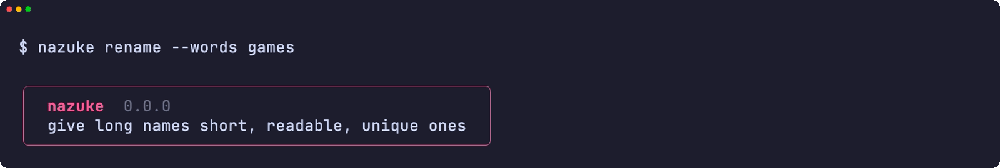
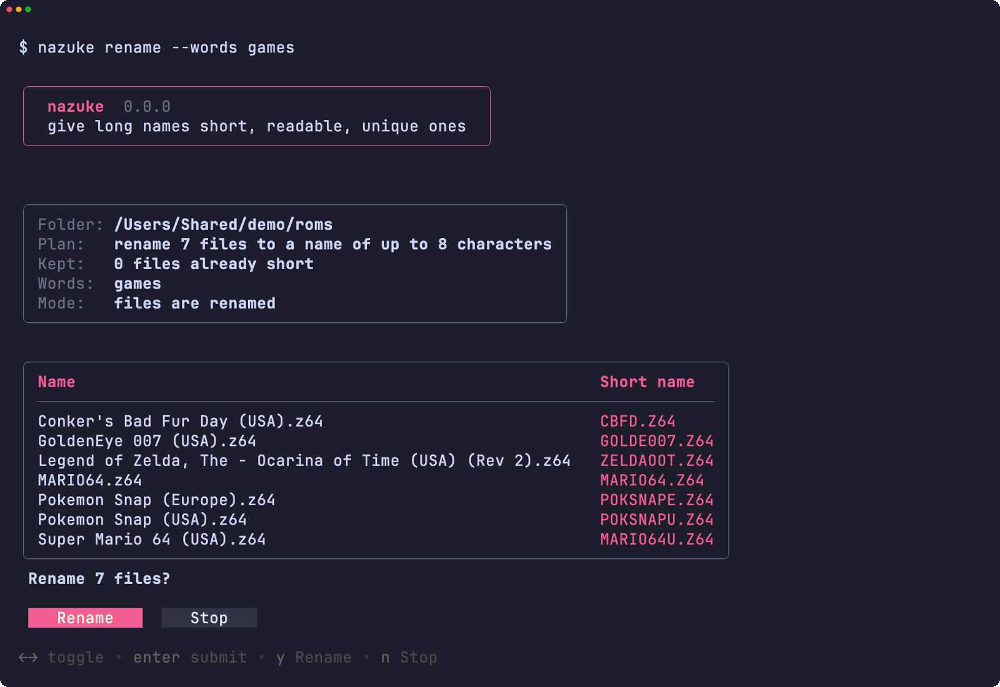
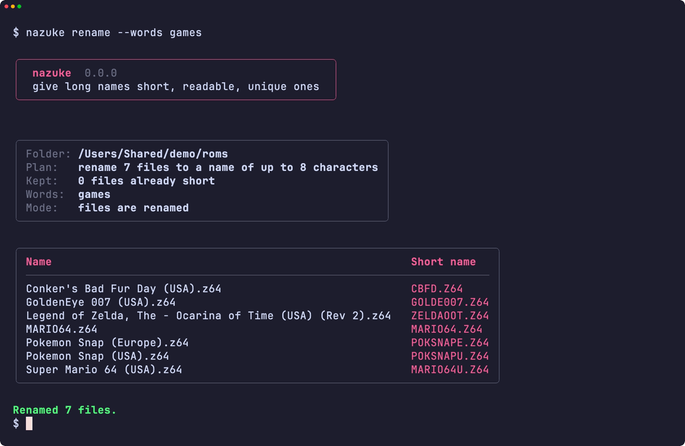
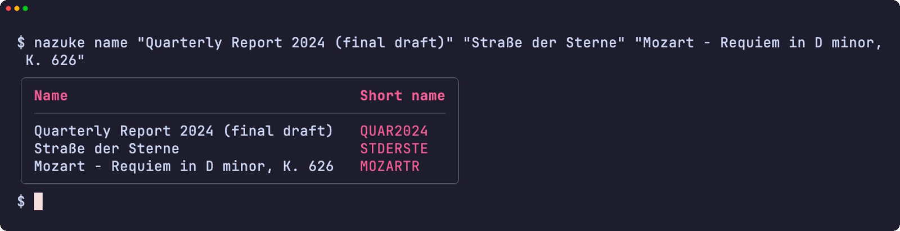
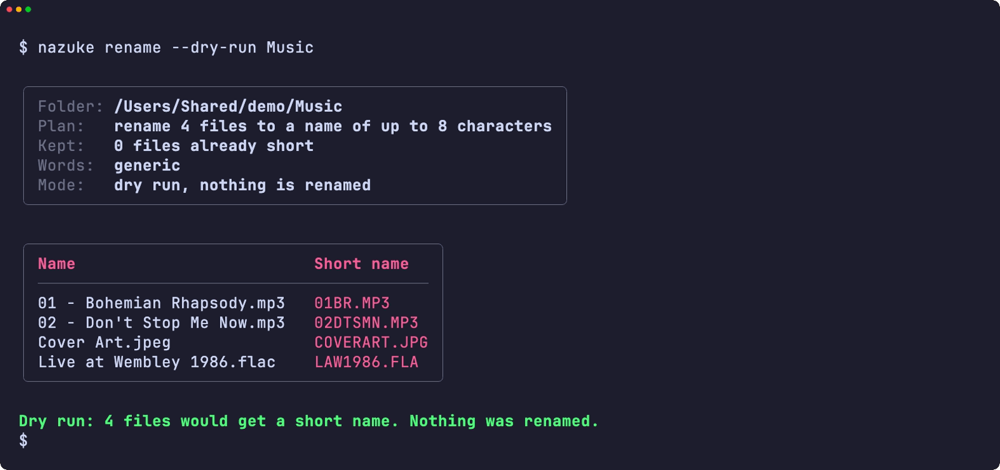
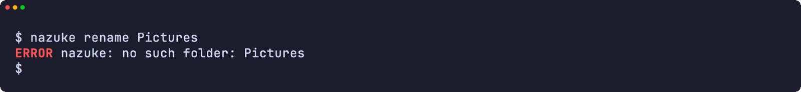
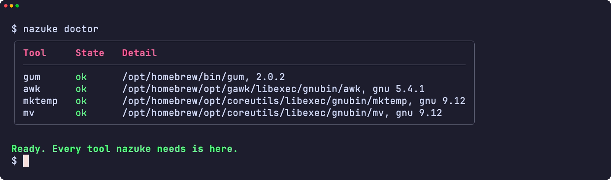
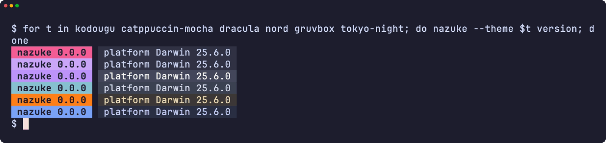
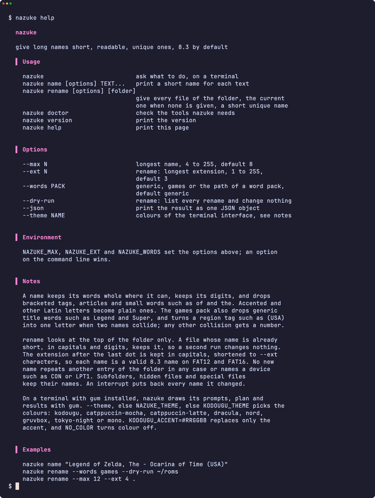

<div align="center">

<h1>nazuke</h1>

<strong>给长名称起一个简短、易读且不重复的名称：默认 8.3 格式，长度可以自由选择。</strong>

[English](README.md) | [日本語](README.ja.md) | 简体中文 | [繁體中文 (香港)](README.zh-HK.md)

[](https://github.com/gufranco/nazuke/actions/workflows/ci.yml)
[](https://github.com/gufranco/nazuke/releases/latest)
[](LICENSE)

<p align="center">
  <a href="#quick-start"><strong>快速开始</strong></a> |
  <a href="#how-names-are-made">名称如何生成</a> |
  <a href="#development">开发</a>
</p>

</div>

`nazuke` 是日语的「名付け」，意为起名。它把 `Legend of Zelda, The - Ocarina of Time (USA) (Rev 2)` 变成 `ZELDAOOT`，而不是 `LEGENDOF`，并给整个文件夹的文件起互不冲突的短名称，适用于只能读取 8.3 文件名的老式播放器、相机、烧录卡和磁盘。它在 [kodougu 系列](FAMILY.md) 中的同伴负责写入和擦除磁盘、整理文件夹以及刻录 Video CD。

---

<p align="center">
  
</p>

```console
$ nazuke rename --words games ~/roms

Folder: /Users/me/roms
Plan:   rename 5 files to a name of up to 8 characters
        keep 1 file whose name is already short
Words:  games

Conker's Bad Fur Day (USA).z64 -> CBFD.Z64
Legend of Zelda, The - Ocarina of Time (USA) (Rev 2).z64 -> ZELDAOOT.Z64
Pokemon Snap (Europe).z64 -> POKSNAPE.Z64
Pokemon Snap (USA).z64 -> POKSNAPU.Z64
Super Mario 64 (USA).z64 -> MARIO64U.Z64
Renamed 5 files.
```

<a id="quick-start"></a>

## 快速开始

### 前提条件

| 工具 | 用途 | 安装 |
|:-----|:----|:--------|
| [`gum`](https://github.com/charmbracelet/gum) | 终端界面：菜单、输入、表格和配色 | `brew install gum`。Homebrew formula 会自动安装 |
| `awk`、`mktemp`、`mv` | 给名称打分并重命名文件 | Linux 和 macOS 系统自带 |

### 安装

```bash
brew install gufranco/tap/nazuke
```

或从源码安装：

```bash
git clone https://github.com/gufranco/nazuke.git
cd nazuke
make install
```

`make install` 会把工具本身、词包、man 手册以及 bash、zsh、fish 补全复制到 `~/.local` 下，并把 `nazuke` 放进 `~/.local/bin`；设置 `PREFIX` 可以改变位置。Homebrew formula 安装的是同样的文件。

### 验证

```console
$ nazuke doctor
gum                ok       /opt/homebrew/bin/gum, 2.0.2
awk                ok       /usr/bin/awk, bsd
mktemp             ok       /usr/bin/mktemp, bsd
mv                 ok       /bin/mv, bsd
```

## 用法

| 命令 | 作用 |
|:--------|:--------|
| `nazuke name [options] TEXT...` | 逐行打印每段文本的短名称 |
| `nazuke rename [options] [folder]` | 给文件夹中的每个文件起一个简短且不重复的名称；不指定文件夹时使用当前文件夹 |
| 不带参数的 `nazuke` | 在终端中询问要做哪一项 |
| `nazuke doctor` | 列出 nazuke 需要的工具，以及每个工具的类型和版本 |
| `nazuke version`、`nazuke help` | 打印版本或完整的用法说明 |

| 选项 | 效果 |
|:-------|:-------|
| `--max N` | 名称的最大长度，4 到 255，默认 8 |
| `--ext N` | 用于 rename，扩展名的最大长度，1 到 255，默认 3 |
| `--words PACK` | 适用于任何名称的 `generic`、适用于发行名称的 `games`，或你自己的词包路径 |
| `--dry-run` | 用于 rename，列出每个重命名，不做任何更改 |
| `--json` | 以一个 JSON 对象输出结果，供脚本使用 |
| `--theme NAME` | 终端界面的配色 |

```bash
nazuke name "Quarterly Report 2024 (final draft)"     # QUAR2024
nazuke rename --dry-run ~/Music                       # 先看名称
nazuke rename --max 12 --ext 4 .                      # 更长的名称，保留 .docx
```

`NAZUKE_MAX`、`NAZUKE_EXT` 和 `NAZUKE_WORDS` 通过环境变量设置相同的选项；命令行上的选项优先。`--` 表示选项结束，因此文本或文件夹可以以短横线开头。nazuke 遵循同系列工具共用的命令行约定，详见 [FAMILY.md](FAMILY.md)。

### 主题

在装有 `gum` 的终端上，nazuke 用 gum 绘制菜单、输入、计划和结果，并在重命名前询问确认；在管道或脚本中，输出保持纯文本。配色依次由 `--theme`、`NAZUKE_THEME`、`KODOUGU_THEME` 决定：`kodougu`（默认）、`catppuccin-mocha`、`catppuccin-latte`、`dracula`、`nord`、`gruvbox`、`tokyo-night` 或 `mono`。`KODOUGU_ACCENT=#RRGGBB` 只替换强调色，`NO_COLOR` 关闭颜色。

<a id="how-names-are-made"></a>

## 名称如何生成

nazuke 先整理名称，再生成几种短形式，最后保留最易读的那个。

- **整理。** 去掉 `(USA)`、`[!]` 这样的括号标签，但保留光盘、磁盘、CD、面、磁带或分部的编号，所以 `(Disc 2)` 的 `2` 会留下。移开像 `Legend of Zelda, The` 那样放在末尾的冠词，并去掉所有格的 `'s`。带重音的字母和其他拉丁字母变成基本字母：`Café` 是 `CAFE`，`Straße` 是 `STRASSE`，`Łódź` 是 `LODZ`。`of`、`the` 这样的短词会被去掉。
- **形式。** 完整的单词、均匀缩短的单词、第一个单词加其余单词的首字母，以及只有首字母的形式；` - ` 或 `: ` 后面的副标题变成首字母。
- **打分。** 完整保留的单词和完整的最后一个单词得分高，截短的单词和只剩一个字母的单词得分低，保留全部数字的形式会加分。丢掉一个单词的扣分是丢掉词包认定为通用词的十倍，所以 `Conker's Bad Fur Day` 变成 `CBFD`，而 games 词包允许 `Legend of Zelda` 丢掉 `Legend`。
- **数字放不下时。** 数字不会被截短，所以长日期或型号可能占满整个名称。这时先去掉五位或以上的数字串，`Pyramid_9820_Brochure_198611` 变成 `PYR9820B`；仍然放不下就去掉所有数字，`IMG 2024 03 11 Beach Sunset` 变成 `IMGBS`。只有数字的名称保留开头的数字。

这个引擎重现了 [n64-mr-backup-z64-python](https://github.com/gufranco/n64-mr-backup-z64-python) 的命名方式，那套规则用 1,414 个真实发行名称调校过；测试用 391 个名称，把结果与那段代码自身的输出逐一核对。其中两个有意不同：那段代码因数字放不下而输出后备词的名称，nazuke 会用其中的单词命名。

### 重命名文件夹

- 名称已经简短、只由大写字母和数字组成的文件保持不变，所以再次运行 nazuke 不会改变任何东西，新文件也不会让旧文件改名。
- 新名称不会与文件夹中的任何项目重复，包括文件、文件夹和隐藏文件，不区分大小写，也不会是 `CON`、`LPT1` 这样的设备名。
- 三个或以上的文件共用 ` - ` 前面的部分，而去掉它能区分更多文件时，这部分会从各自的名称中去掉，所以 `HBMAME (v0.209) - mslughp08.zip` 和同类文件的文件夹会按套件名称命名为 `MSLUGH08`，而不是 `HBMAME` 加编号。同一标题的不同版本，例如 `Legend of Zelda, The - Ocarina of Time (USA)` 和它的 `(Beta)`，会保留共用部分，所以每个名称仍以 `ZELD` 开头。
- 两个名称冲突时，games 词包会加上标签对应的地区字母，所以三个 `Pokemon Snap` 发行版变成 `POKSNAPU`、`POKSNAPE` 和 `POKSNAPJ`。其他冲突则加上编号：`REPORT`、`REPORT1`，只要名称放得下，编号可以超过 999。
- 扩展名会保留，改为大写并缩短到 `--ext` 个字符，`jpeg`、`tiff`、`html`、`mpeg`、`aiff`、`markdown` 和 NES 的 `unif` 使用常见的短形式。只由大写字母和数字组成的名称是有效的 8.3 名称，所以 FAT12 或 FAT16 设备无需长文件名也能读取。只有当最后一个点后面是 1 到 8 个字母和数字、并至少含一个字母时，才算扩展名，所以 `Rally 2.0` 会保留版本号。
- 子文件夹、隐藏文件和特殊文件不改名。符号链接改的是链接本身的名称，不碰它指向的目标。
- 每个文件先移到一个隐藏的临时名称，再移到新名称，所以在不区分大小写的磁盘上也能只改大小写，中断时会把这次运行改过的名称全部恢复。

### 词包

`--words` 接受默认的 `generic`、`games`，或你自己的文本文件路径：

```text
fallback DOC
stopwords OF THE AND
articles THE A AN
droppable DRAFT FINAL COPY
region USA U
```

`fallback` 是没有可保留内容的文本所用的名称，`droppable` 列出可以低代价丢掉的词，每行 `region` 把一个标签词和它的字母配成一对。遇到无法读取的行时，nazuke 会停止并指出那一行。

<a id="portability"></a>

## 可移植性

全部用 POSIX `sh` 和 POSIX `awk` 编写，ShellCheck `-o all` 零警告。测试在 macOS 的 `/bin/sh`、系统自带的 bash 3.2 和 zsh、Homebrew 的最新 bash 和 zsh，以及 Ubuntu 的 `dash`、`bash` 和 `zsh` 下运行。命名在 `LC_ALL=C` 下进行，所以 macOS awk、gawk、mawk 和 BusyBox awk 给出的名称相同。

它能在六种常用工具集上运行：Linux 上的 uutils、GNU 或 BusyBox 工具，以及 macOS 自带的工具、Homebrew 中较新的版本或 Homebrew 的 uutils 工具。CI 在每种工具集上运行全部测试，`nazuke doctor` 会列出 `awk`、`mktemp` 和 `mv` 的类型和版本，让错误报告说明用的是哪些工具。

<a id="screens"></a>

## 画面

<details>
<summary>全部画面均由 <code>make screens</code> 录自真实运行</summary>
<br>

<table>
<tr>
<td width="50%" valign="top"><br><sub>标题下的文件夹输入</sub></td>
<td width="50%" valign="top"><br><sub>计划与确认</sub></td>
</tr>
<tr>
<td width="50%" valign="top"><br><sub>结果</sub></td>
<td width="50%" valign="top"><br><sub>任何文本的短名称</sub></td>
</tr>
<tr>
<td width="50%" valign="top"><br><sub>不做任何更改的试运行</sub></td>
<td width="50%" valign="top"><br><sub>错误</sub></td>
</tr>
<tr>
<td width="50%" valign="top"><br><sub>doctor 检查所需的每个工具</sub></td>
<td width="50%" valign="top"><br><sub>六种主题下的版本标记</sub></td>
</tr>
<tr>
<td width="50%" valign="top"><br><sub>帮助页</sub></td>
<td width="50%" valign="top"></td>
</tr>
</table>

</details>

<a id="development"></a>

## 开发

| 命令 | 说明 |
|:--------|:------------|
| `make fmt` | 用 shfmt 格式化所有脚本 |
| `make lint` | 运行 shfmt，对所有脚本、测试和补全运行 ShellCheck，用 mandoc 检查 man 手册 |
| `make test` | 在系统 `sh` 下运行 `bats` 测试 |
| `make test-all` | 在每种 shell 下运行同样的测试，macOS 上包括 bash 和 zsh 的两个版本 |
| `make test-linux` | 在 Ubuntu 容器中运行同样的测试 |
| `make coverage` | 合并这台 Mac 和 Ubuntu 容器中的 bashcov 行覆盖率，并检查 CI 强制的 100% 门槛 |
| `make screens` | 在 macOS 上用 VHS 从真实工具录制 README 的画面 |

测试在真实文件系统上重命名真实的文件夹，只有故障通过 `PATH` 上的小包装程序注入。推送到 `main` 且 CI 通过后会运行 semantic-release：`feat` 或 `fix` 提交会发布新版本，更新 [`lib/core.sh`](lib/core.sh) 中的 `NAZUKE_VERSION` 和 CHANGELOG，并更新 Homebrew formula。

## 许可证

[MIT](LICENSE)。
